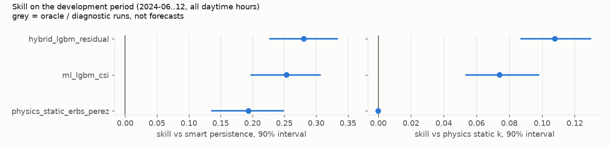
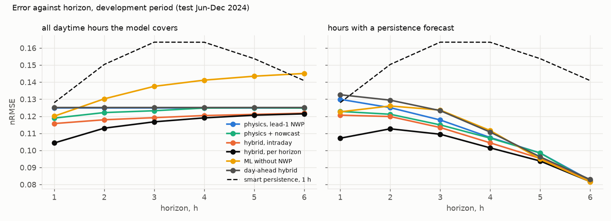
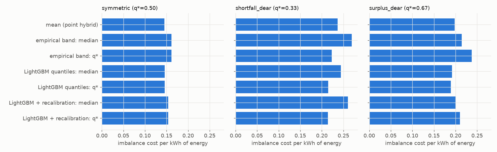
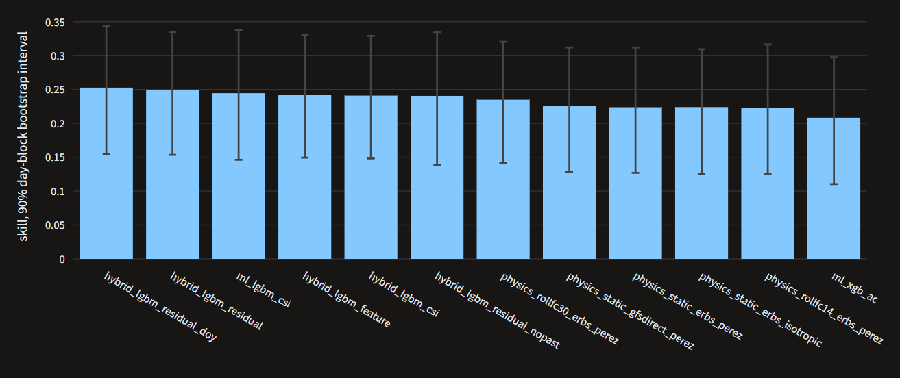
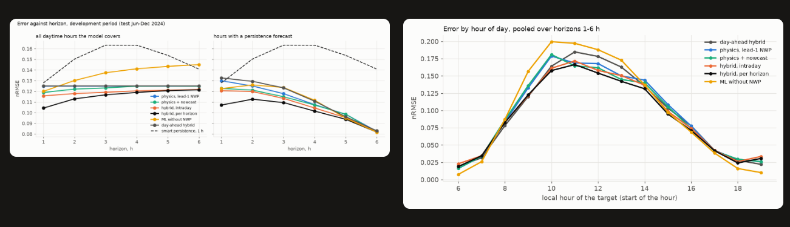
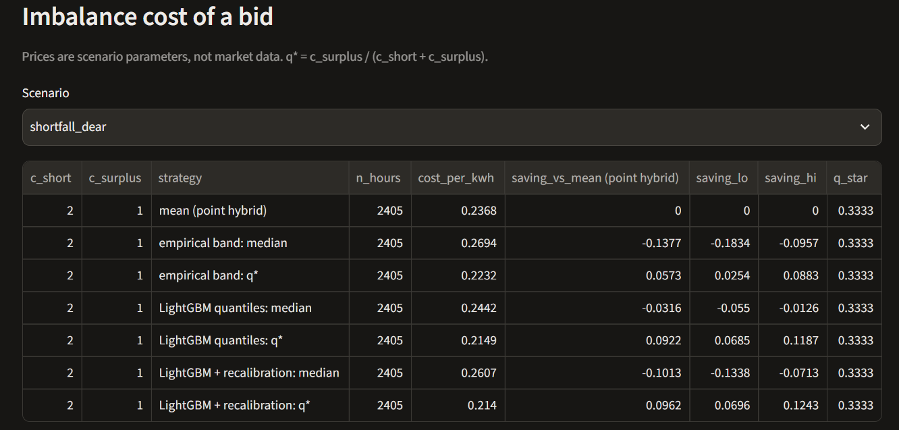
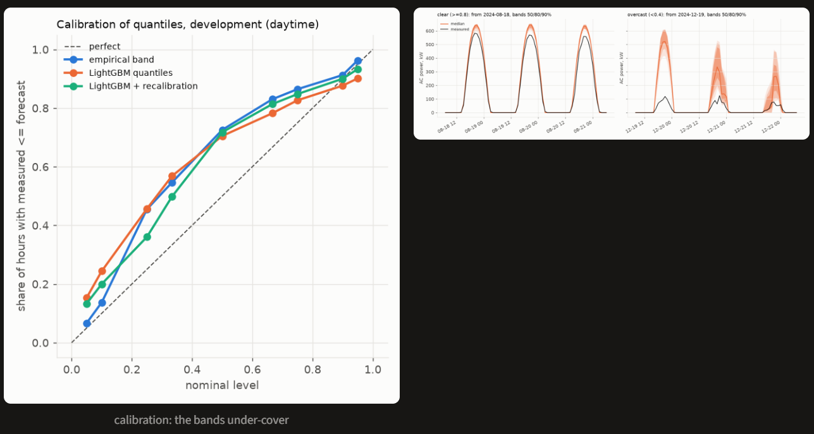
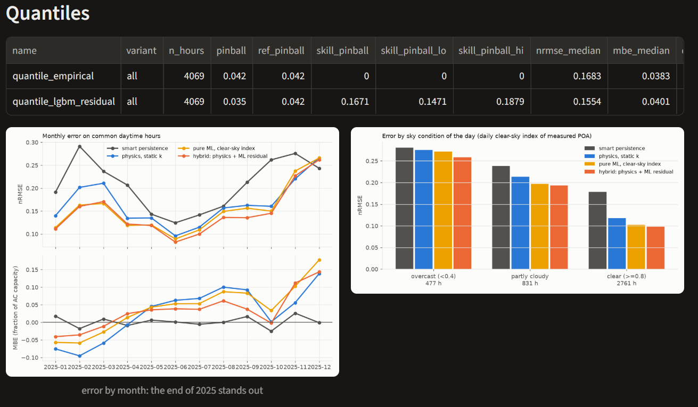

# PV Forecast Arena

**How well can we predict the output of a solar plant for tomorrow and for the next few hours, and which method is worth using?** This project answers that on one real plant by running very different methods (from "same as yesterday" to physics models, gradient boosting and neural networks) under identical, leak-free test conditions, and reporting honestly what worked and what did not.

**Live results viewer:** https://pv-forecast-arena-ddg9bmsxem37hkcw29ye3w.streamlit.app/ (free hosting; it sleeps without visitors and wakes up in about half a minute).

## Contents

1. [The problem in plain words](#1-the-problem-in-plain-words)
2. [Main findings](#2-main-findings)
3. [How it works](#3-how-it-works)
4. [How the numbers are kept honest](#4-how-the-numbers-are-kept-honest)
5. [How to read the metrics](#5-how-to-read-the-metrics)
6. [Results in detail](#6-results-in-detail)
7. [What did not work](#7-what-did-not-work)
8. [Limitations](#8-limitations)
9. [What to expect with other input data](#9-what-to-expect-with-other-input-data)
10. [Tools and skills](#10-tools-and-skills)
11. [Run it yourself](#11-run-it-yourself)

## 1. The problem in plain words

A solar plant produces power that depends on the sun, clouds and temperature. Grid operators and plant owners need a forecast in advance, for two reasons:

- **Day-ahead:** the power for every hour of tomorrow, issued today at 10:00 local time (when bids are placed).
- **Intraday:** the power 1 to 6 hours ahead, updated every hour.

A wrong forecast costs money: if you promise more than you deliver you pay for the shortfall, and a surplus above the promise is sold cheaply. So the useful questions are: how large is the error, can it be reduced, and can the forecast also say *how uncertain* it is?

**Data.** One real plant (NREL PVDAQ system 2107, Arbuckle, California, 893 kW DC, fixed panels tilted 25° facing south), 20 months: February 2024 – December 2025. Measurements are 15-minute AC power and irradiance on the panels. Weather inputs are the **archived forecasts of the GFS weather model** (Open-Meteo "Previous Runs"): what was really published before the forecast time, not the weather that happened.

## 2. Main findings

1. **Physics plus machine learning wins.** A physical model of the plant (pvlib) whose remaining error is learned by LightGBM forecasts tomorrow's hourly output with an error of **14.8% of plant capacity on a full held-out year (2025)**. That is 28% better than the "smart persistence" baseline and 11% better than the physics model alone.
2. **Most of the remaining error is the weather input, not the model.** About 80% of the squared error sits in the irradiance coming from the weather forecast; with perfect weather the ML adds almost nothing over physics. ML mostly corrects the systematic bias of the weather forecast.
3. **For 1–6 hours ahead, a fresher weather forecast matters most.** Error drops by 28% at 1 h and 10% at 6 h against the day-ahead model. Recent plant measurements help only in the first ~3 hours.
4. **Deep learning (LSTM, Transformer) did not beat it** on 20 months of data. They overfit and lose to the hybrid; training longer made it worse.
5. **Uncertainty forecasts have real money value, but the bands are too narrow.** When a shortfall costs twice a surplus, bidding the right quantile cut imbalance cost by 9% (scenario prices, not market data). The nominal 80% band covered only 63% of hours (57% on the hold-out).
6. **The plant changed at the end of 2025.** Output per unit of sunlight fell by 8–13% year over year, and all models over-forecast in November–December 2025. This is reported, not hidden.

## 3. How it works

```
 raw data                 clean + align                forecasting methods                 evaluation
┌──────────────┐     ┌──────────────────────┐     ┌──────────────────────────────┐     ┌───────────────────────┐
│ plant power  │     │ hourly series (UTC)  │     │ 1. baselines (persistence)   │     │ walk-forward splits   │
│ irradiance   │ ──► │ quality flags        │ ──► │ 2. physics model (pvlib)     │ ──► │ metrics + bootstrap   │
│ GFS forecast │     │ leak-proof features  │     │ 3. ML (LightGBM/XGBoost)     │     │ intervals             │
└──────────────┘     └──────────────────────┘     │ 4. hybrid = physics + ML     │     │ held-out year (once)  │
                                                  │ 5. quantiles, 6. deep learn. │     └───────────────────────┘
                                                  └──────────────────────────────┘
```

**The methods, from simple to complex:**

| Method | Idea in one line |
|---|---|
| Persistence | Tomorrow looks like yesterday at the same hour. |
| Smart persistence | The clear-sky curve scaled by how much of it the plant delivered in the last 24 h. This is the reference everything is compared with. |
| Physics (pvlib) | Compute sunlight on the tilted panels from the weather forecast, then module temperature, then DC and AC power with inverter limit. One scale factor is calibrated on the training data. |
| ML (LightGBM, XGBoost) | Learn power directly from weather and sun-position features. |
| **Hybrid (winner)** | Take the physics forecast, and let LightGBM learn only its *error* ("residual"). Physics provides the right shape and scale, ML fixes the habits of the weather forecast. |
| Per-horizon intraday model | Same hybrid, but built on the newest weather run, with the latest measurements, one model per horizon (1…6 h). |
| Quantile models | Instead of one number, predict the 5%…95% quantiles, so the forecast carries uncertainty. |
| LSTM, Temporal Fusion Transformer | Neural networks on 48 h of history plus weather inputs, for comparison. |

**Why the hybrid works:** trees alone do not know that a plant produces more at noon in June than in December, so they extrapolate badly; physics alone has systematic biases because the weather forecast is imperfect. The hybrid uses each where it is strong.

## 4. How the numbers are kept honest

Forecasting results are easy to inflate by accident. These rules were applied throughout:

- **No look-ahead.** Every feature goes through one allow-list. For day-ahead only information available at 10:00 on the previous day is allowed. Tests deliberately corrupt all data after the forecast time and check that the forecast does not change (and a "mutation check" confirms that the test can actually fail). 147 automated tests.
- **Walk-forward testing.** Models are trained on the past and tested on the following month, then retrained, moving through time. A 2-day gap (embargo) separates training from test data. No random shuffling.
- **Intervals on every claim.** Improvements come with a 90% interval from a bootstrap over whole days (hours of one day are not independent). **Rule fixed in advance: if the interval includes 0, the simpler model wins.**
- **Fixed hyper-parameters.** Not tuned on the test folds, so the development result is not inflated. The list of runs per stage was fixed before looking at results; later additions are marked "after results".
- **Hold-out year.** 2025 was kept aside during development. It has since been used (once for the day-ahead winners, once, frozen, for the intraday and quantile winners), so it is **no longer independent**: new experiments are judged on 2024 only.
- **Reproducibility.** Each experiment is a YAML file; every run is logged to `results/experiments.csv` with git commit, config hash and a "dirty tree" flag; touching the hold-out is refused on a dirty tree.

## 5. How to read the metrics

| Term | Meaning |
|---|---|
| **nRMSE** | Typical forecast error as a share of the plant's capacity (708 kW). 0.15 means about 15% of capacity. Large errors weigh more. Lower is better. |
| **nMAE** | Average absolute error, same scale. |
| **MBE (bias)** | Average signed error. Positive: the model over-forecasts. |
| **Skill score** | 1 − error(model) / error(reference). +0.28 means 28% less error than the reference. 0 means no better, negative means worse. |
| **[a; b]** | 90% bootstrap interval of the skill. If it contains 0, the difference is not distinguishable from chance. |
| **all / clean** | `all` uses all daytime hours; `clean` drops hours with data problems (outages, stuck sensor). |
| **Pinball loss** | Error measure for quantile forecasts. |
| **Coverage** | Share of hours in which the measured power fell inside the forecast band. An 80% band should give 80%. |

All metrics use **daytime hours only**, and the reference is **smart persistence** unless stated.

## 6. Results in detail

### 6.1 Day-ahead

| Model | nRMSE 2024 (development) | nRMSE 2025 (hold-out) |
|---|---|---|
| smart persistence (reference) | 0.167 | 0.206 |
| physics (pvlib, static calibration) | 0.129 (skill +0.22) | 0.166 (+0.19 [0.14; 0.25]) |
| LightGBM on power, no physics | 0.134 | — |
| LightGBM on clear-sky index | 0.126 | 0.154 (+0.25) |
| **Hybrid: LightGBM on the physics residual** | **0.125 (+0.25)** | **0.148 (+0.28 [0.23; 0.33])** |
| LSTM / TFT | 0.132 / 0.138 | not run (not adopted) |

What the comparison says:

- **Calibrating the physics to the plant** brings the biggest single gain (+0.075 [0.060; 0.092] over the uncalibrated chain).
- **The hybrid adds a smaller, real step** over physics: +0.033 [+0.006; +0.062] in 2024 (borderline; 8 comparisons were made) and +0.108 [+0.087; +0.130] on the hold-out, so it was not a fluke.
- **Where the error comes from.** With perfect (observed) weather the hybrid's error falls to 0.110 and its advantage over physics disappears (+0.020, interval includes 0). A diagnostic run that uses the plant's own irradiance sensor reaches 0.055. In squared-error terms: ~30% is the error of the GFS forecast, about half is the gap between reanalysis irradiance and what the plant sensor sees, ~20% is plant-model error.
- **Training strategy.** Training windows of 2–6 months versus an ever-growing window, and monthly versus one-off training, are statistically indistinguishable, so the simplest (growing window, monthly retraining) stays.
- **By sky.** On clear days the hybrid is clearly better than physics; on overcast days the gain is small or negative.



### 6.2 Intraday, 1–6 hours ahead

A separate hybrid model per horizon, built on the newest weather run, plus plant measurements that are known one hour after each hour ends.

| Horizon, h | 1 | 2 | 3 | 4 | 5 | 6 |
|---|---|---|---|---|---|---|
| nRMSE, 2024 | 0.104 | 0.113 | 0.117 | 0.119 | 0.121 | 0.121 |
| Skill vs day-ahead hybrid, hold-out | +0.277 [0.237; 0.315] | | | | | +0.095 [0.058; 0.129] |

Averaged over horizons the gain over day-ahead is +0.073 [+0.036; +0.113] (2024) and +0.152 [+0.114; +0.187] (hold-out).

- The fresher weather forecast alone (physics on it, no ML) is as good as the day-ahead hybrid: most of the intraday gain is **better weather input, not clever nowcasting**.
- Recent measurements help noticeably only for h ≤ 3. Models using measurements only (no weather forecast) are worse than day-ahead at every horizon.
- At h = 6 the gain was zero in 2024 and +0.095 on the hold-out: treat long horizons as "somewhat better", not as a precise number.



### 6.3 Uncertainty and the value of a bid

LightGBM quantile regression on the physics residual (levels 5%…95%) is compared with an empirical band of past errors. Pinball skill: +0.143 [+0.113; +0.174] (2024), +0.167 [+0.147; +0.188] (hold-out).

**Money value.** A bid *b* against actual power *y* costs `c_short·max(b−y,0) + c_surplus·max(y−b,0)`. The cheapest bid is the quantile `q* = c_surplus / (c_short + c_surplus)`. **Prices are assumptions, not market data.** Cost against bidding the point forecast (2024):

| Scenario | q* | Saving of the quantile bid |
|---|---|---|
| shortfall and surplus cost the same | 0.50 | −0.4% [−2.8; +1.7] (no difference) |
| shortfall twice as expensive | 0.33 | **+9.2% [6.9; 11.9]** |
| surplus twice as expensive | 0.67 | +4.5% [0.1; 8.4] (borderline) |

Meaning: with symmetric prices a better median does not save money; with asymmetric prices, shifting the bid to the right quantile does.



### 6.4 Deep learning

LSTM and TFT (darts, CPU, fixed hyper-parameters) lose to the hybrid: skill against it −0.057 [−0.105; −0.018] and −0.103 [−0.153; −0.066]. The TFT's quantiles are also worse than LightGBM's (−0.124 [−0.187; −0.069]). Training four times longer made the LSTM worse (0.147): this is overfitting. With 5–8 thousand training hours, networks have too little data to learn what physics already knows.

## 7. What did not work

Reported on purpose; these are results too.

- **Deep learning** did not beat physics + trees.
- **ML without physics is worse than physics alone** (−0.034): trees cannot extrapolate the plant's scale. Predicting the clear-sky index fixes this; predicting the physics residual is best but not significantly better than the clear-sky index.
- **Quantile bands under-cover.** The nominal 80% band covered 63% of hours (2024) and 57% (hold-out); the empirical band 78% and 64%. Forecasts lean upward. A post-hoc fix (shifting the quantiles by the last 30 days' error) raised coverage to 70% but worsened pinball loss and cost, so it was rejected.
- **Rolling recalibration of physics** (30-day scale factor) was not significantly better than a static one (+0.014 [−0.007; +0.032]).
- **Window length** and the **day-of-year** feature brought nothing measurable.
- **Past measurements as day-ahead features** are not significantly useful (+0.012 [−0.009; +0.030]).
- **Nowcast correction** (fading the last hour's error) helps only at h = 1–2, and not significantly.
- **ECMWF weather model** was planned as a comparison, but its archive covers only part of the period.

## 8. Limitations

1. **Station drift at the end of 2025.** Output per unit of measured irradiance fell about 8–13% year over year at the same sky type, and all models over-forecast (hybrid bias +0.11 / +0.14 of capacity in November / December 2025). December 2025 was also much cloudier than December 2024, which every model handles worst; in December smart persistence beat all models. Soiling, degradation, sensor drift or unmodelled losses cannot be told apart with the available data. Hold-out numbers include this period.
2. **Wide intervals.** About 200 independent days per period. A borderline lower bound (for example +0.006 for hybrid versus physics in 2024) remains borderline.
3. **Fixed hyper-parameters** by design. Tuning, especially for the networks, could help somewhat.
4. **One plant, 20 months.** Conclusions about deep learning and window length are specific to this data volume.
5. **Hold-out no longer independent** (see section 4).
6. **Imbalance prices are scenarios**, not market data.
7. **Capacity (708 kW) is an estimate** (observed maximum); absolute nRMSE shifts slightly with it, comparisons do not.

## 9. What to expect with other input data

These are expectations drawn from the error breakdown above, **not tested results**.

- **Better weather input is the main lever.** About 80% of the squared day-ahead error sits in the irradiance input. A high-resolution local model, an ensemble (which also gives honest uncertainty) or a blend of GFS with ECMWF/ICON would help more than changing the learner.
- **Satellite cloud motion or sky cameras for 1–3 h.** Plant history cannot see approaching clouds; these are the usual remedy at those horizons.
- **Several years of history.** Allows multi-year seasonality, proper tuning on a separate period and a fair test of neural networks, which I would expect to become competitive (not necessarily better).
- **Several plants.** A shared model with plant-specific corrections usually helps data-poor plants and separates plant drift from regional effects.
- **Inverter or string data and a cleaning/maintenance log.** Would show whether the 2025 drop is soiling, a failing string or a sensor problem, so it can be corrected in the physics rather than absorbed by the trees.
- **Real market prices.** Would turn the scenario analysis into an actual value estimate.
- **Calibrated probabilistic inputs.** Weather ensembles, or a calibration window spanning several seasons, are the likely cure for the under-covering bands.

## 10. Tools and skills

| Area | Tools |
|---|---|
| Data and features | pandas, numpy, pyarrow (parquet cache), pvanalytics (quality flags), Open-Meteo API, NREL PVDAQ on AWS |
| PV physics | pvlib (clear-sky, Erbs, Perez, IAM, SAPM, PVWatts) |
| Machine learning | LightGBM, XGBoost, scikit-learn |
| Deep learning | darts, PyTorch (CPU), PyTorch Lightning |
| Evaluation | own walk-forward splitter, day-block bootstrap, pinball / imbalance cost, matplotlib |
| Engineering | YAML experiments, experiment registry in CSV, pytest (147 tests incl. leakage tests), ruff, git |
| Reporting | Streamlit, Plotly |

LightGBM settings: 15 leaves, at least 50 samples per leaf, learning rate 0.03, feature and bagging fraction 0.8, number of trees set by early stopping on the last 30 days of the training window (with a gap), then refit on all of it.

## 11. Run it yourself

**Viewer** (reads the result tables only, computes nothing):

```bash
pip install -e ".[app]"
streamlit run app/main.py
```

Hosted: https://pv-forecast-arena-ddg9bmsxem37hkcw29ye3w.streamlit.app/

| | |
|---|---|
|  |  |
| Day-ahead skill with 90% intervals: the top models overlap, so the simpler one is chosen | Intraday error by horizon and hour of day |
|  |  |
| Imbalance cost where shortfall is expensive | Calibration: the bands under-cover |
|  | |
| Hold-out 2025: error grows and bias turns positive at the end of the year (station drift) | |

**Full pipeline:**

```bash
python -m venv .venv
.venv\Scripts\activate        # Windows
pip install -e ".[dev]"       # add ,dl for the deep-learning models
python scripts/download_data.py --config configs/base.yaml
python scripts/download_weather.py --config configs/base.yaml
python scripts/build_dataset.py --config configs/base.yaml
python scripts/run_experiment.py --config configs/experiments/hybrid_lgbm_residual.yaml
python scripts/run_intraday.py --config configs/experiments/intraday_lgbm_perh.yaml
python scripts/run_quantiles.py --config configs/experiments/quantile_lgbm_residual.yaml
pytest
```

**Repository layout:**

```
app/            Streamlit results viewer
configs/        base config + one YAML per experiment (configs/experiments/)
results/        comparison tables (stage*.csv, holdout*.csv), experiment registry, figures
scripts/        download, run_experiment / run_intraday / run_quantiles, compare_* reports
src/pv_forecast_arena/
    data/       PVDAQ + Open-Meteo loaders, cleaning, flags
    features.py allow-list of features; the only path to past measurements and lead-1 forecasts
    models/     baselines, physics (pvlib), tabular/gbm/hybrid, intraday, quantile, dl
    evaluation/ splits, metrics, bootstrap skill, quantile and cost scoring, registry
tests/          unit tests and leakage tests (corrupt the future, the forecast must not move)
```

## Author

Marharyta Cherkashyna — solar PV design engineer moving into PV performance & ML.
